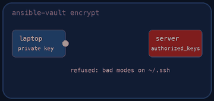
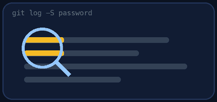

<p align="center"></p>

| | |
|-|-|
| **Time** | 75-90 min |
| **Cost** | free |
| **You need** | Ansible (ansible-core 2.15 or newer), Docker, git, an SSH client and a terminal (Linux, macOS, or Windows with WSL) |

## How this lab works

1. **Fork** this repository to your own GitHub account (button at the top right).
2. Clone **your fork** in your Ubuntu environment (WSL on Windows, your OrbStack machine on Mac).
3. Read the lab below (the same text is in [`LAB.md`](LAB.md)) and follow the mission.
4. Answer the questions in [`SUBMISSION.md`](SUBMISSION.md). Where a question asks for output, paste it in a code block. No screenshots needed.
5. Commit and push. Open the **Actions** tab of your fork (click *I understand my workflows, go ahead and enable them* the first time). The **Lab check** shows what is still missing.
6. When the check is green, **submit the URL of your fork** in the course platform.

> [!NOTE]
> The check only looks at your answers and any files the lab asks you to commit. Your instructor reads your work and may ask you to explain any line.

<p align="center"></p>

## 🎬 The situation

<p align="center"></p>

Monday, 09:10. A message from the security team: *"Your infrastructure repository contains the production database password. It has been there since Friday. It is in the history of every clone. Fix it today."*

They are right. A well-meaning teammate committed `group_vars/all.yml` with the PostgreSQL and Redis passwords of Pollie's data tier. The playbook works, production works, and the secrets are readable by everybody who ever had access to the repository.

You will not just delete the file. You will **rotate** the secrets, move them into **Ansible Vault**, make the playbook run without anybody typing a password, and prove that nothing leaks, not into the repository and not into the playbook output.

> [!IMPORTANT]
> **Your mission**
> - Find out how bad the leak is, and why deleting the file does not fix it
> - Encrypt the secrets with Ansible Vault and wire the vault password so nobody types it
> - Rotate: generate new passwords and push them to the servers with Ansible
> - Stop the playbook from printing secrets, even with `-vv --diff`
> - Prove that the old passwords are dead and the new ones work

**Time:** 75-90 min | **Cost:** free | **You need:** Ansible (`ansible-core` 2.15 or newer), Docker, git, an SSH client and a terminal. On Windows use WSL. `./teardown.sh` removes the lab.

<p align="center"></p>

## Part 0 - Set the scene

Fork this repository, clone your fork, and install the Ansible collection the playbook uses:

```bash
ansible-galaxy collection install community.postgresql
./setup.sh
```

The setup builds two servers and runs the playbook **as it is**, so production looks exactly as it did on Friday: `pv-db` runs PostgreSQL and Redis with the leaked passwords, `pv-app` has an environment file with them in it.

Read `site.yml`, `group_vars/all.yml` and `templates/pollie.env.j2`. Everything works. That is the problem.

<p align="center"></p>

## Part 1 - How bad is it?

<p align="center"></p>

1. Prove the leak is real. The passwords work **right now**:

```bash
docker exec -e REDISCLI_AUTH='redis-prod-pass' pv-db redis-cli ping
docker exec -e PGPASSWORD='Winter2023!' pv-db psql -h 127.0.0.1 -U pollie -d pollie -tAc 'select current_user'
```

2. Look at where the secret lives in Git: `git log --oneline`, then `git log -S"Winter2023" --all --oneline`. Remove the file with `git rm group_vars/all.yml`, commit, and search again. Is the password still findable? (`git show <first commit>:group_vars/all.yml`)

> [!NOTE]
> **Think** Deleting the file only removes it from the *latest* snapshot. Every clone, every fork and every CI cache still has the history. Rewriting history (`git filter-repo`) helps for the future but cannot reach copies that already exist. What is the only thing that makes a leaked secret harmless?

The rest of the lab follows from the answer: **rotate first, hide second**.

<p align="center"></p>

## Part 2 - The vault

Ansible Vault encrypts a file (or a single value) with a password, so the encrypted result can safely live in Git.

The convention you will use:

| File | Content | Committed? |
|------|---------|------------|
| `group_vars/all/vars.yml` | normal variables; `db_password: "{{ vault_db_password }}"` and `redis_password: "{{ vault_redis_password }}"` | yes |
| `group_vars/all/vault.yml` | the real values as `vault_db_password` and `vault_redis_password`, **encrypted** | yes |
| `.vault_pass` | the vault password, one line | **never** |

Why two files? Anybody reading `vars.yml` sees which variables exist and where they point; only `vault.yml` is opaque, and `grep db_password` still finds the usage.

Do this:

1. Create the `group_vars/all/` directory, move the **non-secret** variables (`db_name`, `db_user`) into `vars.yml` and point the two password variables at the `vault_` ones. Delete `group_vars/all.yml` (a file and a directory with the same name merge, and you do not want the old file around).
2. Choose a vault password and put it in `.vault_pass`. Add `.vault_pass` to `.gitignore` **before** anything else, then check with `git status` that it is not listed.
3. Tell Ansible where the password is, so nobody types it. In `ansible.cfg` set `vault_password_file` (the TODO line).
4. **Generate new secrets**, never reuse the leaked ones. Something long and random, letters and digits only (they end up in a URL, and `openssl rand -hex 16` is enough):

```bash
openssl rand -hex 16
```

5. Create `group_vars/all/vault.yml` with `vault_db_password` and `vault_redis_password`, then encrypt it:

```bash
ansible-vault encrypt group_vars/all/vault.yml
```

6. Check what you committed will look like, and that you can still read it:

```bash
head -2 group_vars/all/vault.yml     # $ANSIBLE_VAULT;1.1;AES256 and a block of hex
ansible-vault view group_vars/all/vault.yml
ansible-vault edit group_vars/all/vault.yml      # change a value, then change it back
```

> [!NOTE]
> **Think** AES256 is strong, so the file can be public. What is the weak spot now? (Hint: look at where you keep `.vault_pass` and who can read your laptop, your CI settings and your backups.)

<p align="center"></p>

## Part 3 - Rotate: put the new passwords on the servers

The playbook already uses `db_password` and `redis_password`, so you do not have to change it to switch to the vaulted values. Apply it:

```bash
ansible-playbook site.yml
```

Which tasks changed? Which handler ran? The password of the PostgreSQL user, Redis' `requirepass` and the environment file on `pv-app` all moved to the new value in one run.

Now the lab's proof of rotation. The old passwords must **fail** and the new ones must **work**:

```bash
docker exec -e REDISCLI_AUTH='redis-prod-pass' pv-db redis-cli ping           # must fail now
docker exec -e PGPASSWORD='Winter2023!' pv-db psql -h 127.0.0.1 -U pollie -d pollie -tAc 'select 1'   # must fail now
```

Do the same with the new values (read them with `ansible-vault view`). Note what `docker exec pv-app cat /etc/pollie/pollie.env` shows and who may read that file.

> [!TIP]
> **Checkpoint** Both old logins fail with an authentication error, and a second `ansible-playbook site.yml` shows `changed=0`.

<p align="center"></p>

## Part 4 - Check that the playbook does not talk too much

Secrets do not only live in files. They end up in **logs**: CI output, terminal scrollback, chat messages with a pasted error. Create some drift so the secret-carrying tasks have something to change:

```bash
docker exec pv-db sh -c "sed -i 's/^requirepass.*/requirepass drifted-by-hand/' /etc/redis/redis.conf"
docker exec pv-db su postgres -c "psql -c \"ALTER USER pollie PASSWORD 'drifted-by-hand'\""
docker exec pv-app sh -c "echo '# edited by hand' >> /etc/pollie/pollie.env"
```

Now run the playbook as a pipeline would, with verbose output and diffs:

```bash
ansible-playbook site.yml -vv --diff
```

Read it carefully. Look for the new passwords, in the module arguments, in the diff of `redis.conf` and in the diff of the environment file. Every task that handles a secret needs `no_log: true`. Add it where you find a leak, and run again after creating the drift once more.

> [!NOTE]
> **Think** `no_log` hides the module's arguments and result, which also hides the error message when the task fails. How would you debug a failing `postgresql_user` task that has `no_log: true`? (Hint: `no_log: "{{ hide_secrets | default(true) }}"` lets you flip it with `-e hide_secrets=false`. Why only ever on your own machine, never in CI?)

<p align="center"></p>

## Part 5 - Rekey, and what comes next

1. **Rekey**: change the *vault password* without touching the secrets inside. Do it, and use a new `.vault_pass`:

```bash
echo 'a-new-long-vault-password' > .vault_pass_new
ansible-vault rekey group_vars/all/vault.yml --new-vault-password-file .vault_pass_new
mv .vault_pass_new .vault_pass
ansible-playbook site.yml    # still changed=0
```

   Rekeying and rotating are two different operations. Write down in your own words when you need each: someone who knew the vault password leaves the team (rekey), or a secret itself is exposed (rotate).

2. **One value at a time**: `ansible-vault encrypt_string 'value' --name 'vault_something'` produces an inline-encrypted variable that you can paste in any YAML file. When is that nicer than an encrypted file, and when is it worse?

3. **Vault IDs**: `--vault-id dev@.vault_pass_dev --vault-id prod@.vault_pass_prod` lets one repository hold secrets for several environments with different passwords. Why would you want that?

<p align="center"></p>

## Part 6 - Prove it

<p align="center"></p>

```bash
./verify.sh
```

It reads your vault without a prompt, checks that nothing readable in the working tree contains an old **or** a new password, applies the playbook (rotating the servers), tests that the old logins are dead and the new ones live, creates drift and runs `-vv --diff` to see whether a password slips into the output. Fix what is red and run it again until it ends with **ALL CHECKS PASSED**.

> [!TIP]
> **Stuck?** If Ansible says "Attempting to decrypt but no vault secrets found", `vault_password_file` is missing or points at the wrong place. If `.vault_pass` shows up in `git status`, the `.gitignore` entry has a typo. If the PostgreSQL login fails after rotation with a password that "looks right", check for characters that mean something in a URL (stay with `openssl rand -hex`). If a secret still appears in `-vv --diff`, search the output for the first characters of the password to find the task.

<p align="center"></p>

## Level up (optional)

- Add a Git **pre-commit hook** (`.githooks/pre-commit`, enabled with `git config core.hooksPath .githooks`) that refuses to commit a file under `group_vars/` that does not start with `$ANSIBLE_VAULT`.
- Run the playbook in a GitHub Actions workflow with the vault password in a repository secret: `echo "$VAULT_PASS" > .vault_pass` in a step, never in the YAML. What does the job log show if you forget `no_log`?
- Compare with a real secrets manager (AWS Secrets Manager, HashiCorp Vault): rotation, auditing and per-secret access control are what Ansible Vault cannot give you.

<!-- teardown:start (generated by labs.py, do not edit) -->
## Tear down (mandatory)

<p align="center"></p>

Resources left behind cost money, keep doors open and pollute the next lab. Removing what you created is part of the job, so it is part of the submission: **you must prove it is gone**.

Do this **last**, after you have pasted your `verify` output into `SUBMISSION.md` (once you tear down, the lab can no longer be verified).

1. {'Run `./teardown.sh`. It removes the two servers (labelled `lab=ansible-vault-pollie`), their network and the SSH keys. Your vault files, the `.vault_pass` file and answers stay on your machine (the password file is gitignored': 'delete it yourself if you want).'}

Then run the proof:

```bash
./verify-teardown.sh
```

It prints a list of checks and must end with **TEARDOWN VERIFIED**. If it reports leftovers, remove them and run it again. Paste the full output in your submission.
<!-- teardown:end -->

<!-- submission:start (generated by labs.py, do not edit) -->
## 📬 Submission

Answer the questions in `SUBMISSION.md` in **your fork** (paste output in code blocks where asked), push, then submit the **URL of your fork**.

**Files to commit**

- `group_vars/all/vars.yml`: plain variables that point at the vaulted ones
- `group_vars/all/vault.yml`: the encrypted secrets (committed)
- `ansible.cfg`: points at your vault password file (the file itself is never committed)
- `site.yml`: with `no_log` where a secret passes through

**Questions to answer**

1. Paste `git log --oneline -S"Winter2023" --all` (or similar) from your fork and the line from `git show` that proves the old password is still in the history even after you deleted the file. Why is deleting the file not a fix, and why is rotating the password the only real fix?
2. Paste the first two lines of `group_vars/all/vault.yml` as committed (it must start with `$ANSIBLE_VAULT;1.1;AES256`) and `cat group_vars/all/vars.yml`. Why two files with a `vault_` prefix convention instead of one encrypted file?
3. Where does your vault password live, how does Ansible find it, and what stops it from being committed? Paste your `.gitignore` line and the `ansible.cfg` line.
4. Paste `ansible-vault view group_vars/all/vault.yml` with the values replaced by `<hidden>` and the command you used to generate them. How long are they and why does the length matter?
5. Before `no_log`, which tasks printed a secret in the output (run `ansible-playbook site.yml -v --diff` after the drift you create in Part 5)? Paste the offending line with the secret hidden, then the same task after `no_log: true`. What do you lose when you use `no_log`, and how do you debug a task that fails behind it?
6. Prove the rotation worked: paste the failed login with the old PostgreSQL password and Redis password, and the successful one with the new passwords.
7. Rekey the vault (`ansible-vault rekey`) and paste the commands. When must you rekey, and why is that different from rotating the secrets inside it? Name one reason to use vault IDs (`--vault-id dev@... --vault-id prod@...`).
8. Where would the vault password live in a CI pipeline (for example GitHub Actions), and what is still a weakness of Ansible Vault compared with a secrets manager such as AWS Secrets Manager or HashiCorp Vault? One sentence each.
9. Paste the output of `./verify.sh`. It must end with **ALL CHECKS PASSED**.
10. **Tear down.** Paste the output of `./verify-teardown.sh`. It must end with **TEARDOWN VERIFIED**.
<!-- submission:end -->
